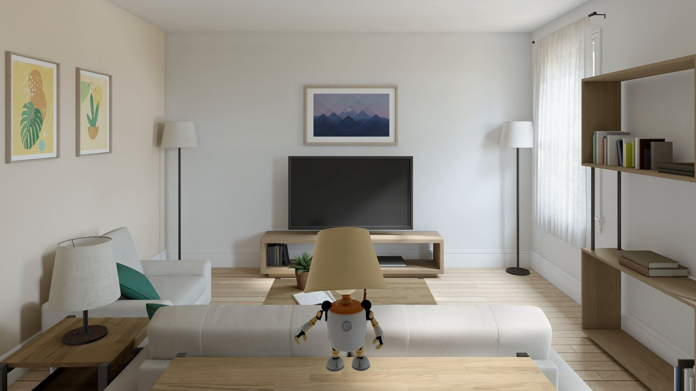
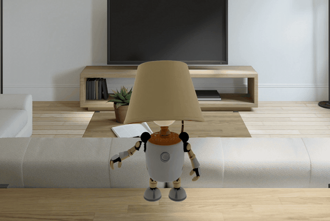
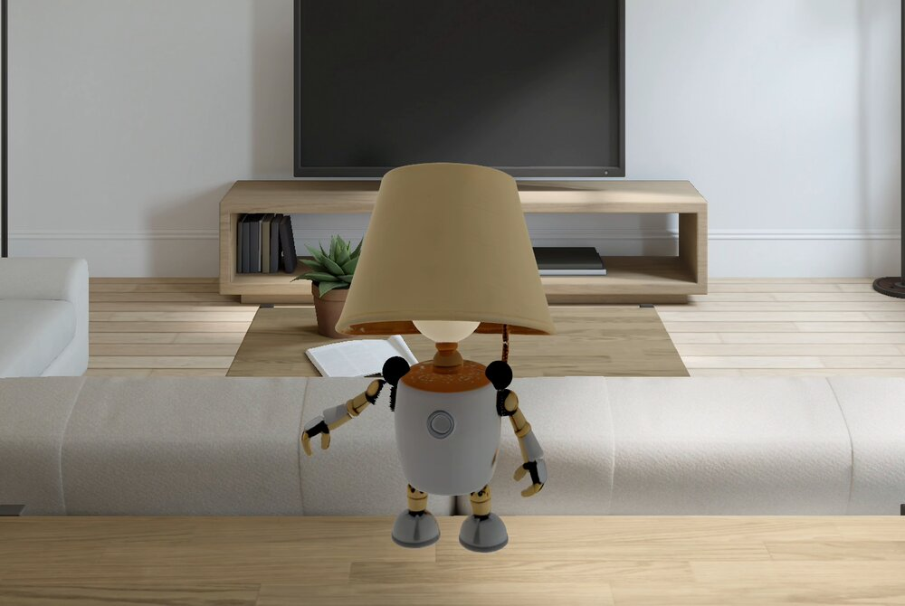
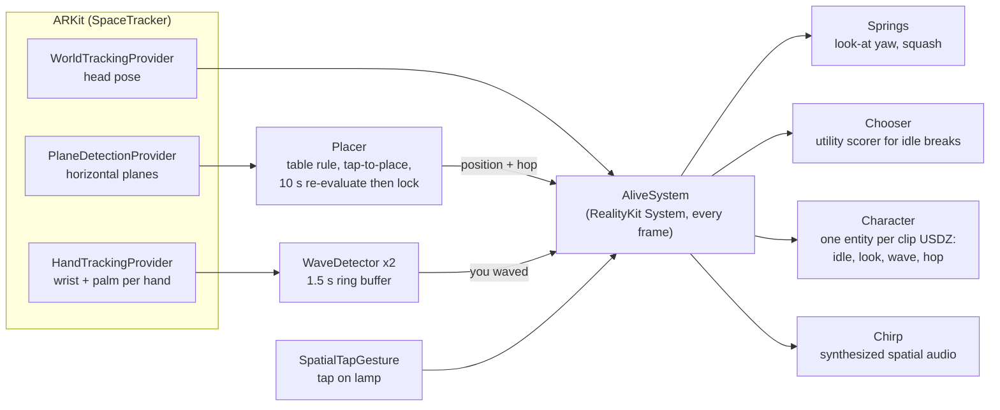
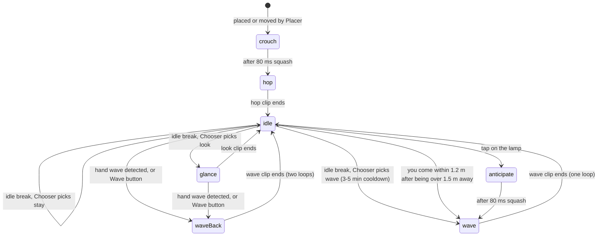
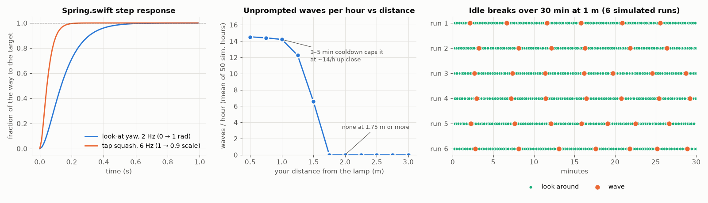

# vision-cast



A small visionOS app that makes one AI-generated character feel alive on your real
table. The character is a lamp robot that a local text → image → 3D pipeline made
([local-3d](https://github.com/mthomas100/local-3d), the `m3d` command). The app finds a
table with ARKit plane detection and stands the lamp on it. The lamp turns to look at
you, breathes, sways, and breaks its idle every 8–20 s. It waves and chirps when you
tap it or walk up to it, and when hand tracking sees you wave at it, it waves back.
Nothing in it is scripted animation in the film sense: a RealityKit `System` blends
four short clips with springs, a small utility scorer and a hand-wave detector. It
runs on Apple Vision Pro (visionOS 26+) and in the visionOS simulator. This is v0
(October 2026).

## Demo

<p align="center"></p>

*Recorded in the visionOS simulator, 2026-10-05: 22 s at 12 fps, real time. The lamp
plays a wave-back (two loops of the wave clip with a 4° lean), settles into idle
breathing and sway while it tracks the camera, then takes an idle break to look
around. The wave here came from the `VC_AUTO_WAVE` switch, because the simulator has no
hand tracking.*

| idle | waving |
|---|---|
|  |  |

About the simulator footage: the simulator has no plane detection, so these captures
use the floor fallback lifted to 1.1 m (`VC_FALLBACK_Y=1.1`). The lamp lines up with the
simulated room's coffee table by perspective only; on a headset it stands on the
detected table. The launcher window, which doubles as the debug overlay, was dismissed
for these captures by a one-line capture-only patch (`dismissWindow(id: "launcher")`
after the space opens) that is not in this repo. The lamp is AI-generated (see
credits).

## How it works



Every frame, `AliveSystem` composes the lamp's transform from a few small layers:

- **Look-at.** Yaw toward your head through a critically damped spring (2 Hz), with a
  ±70° clamp around the direction it was placed facing. Every 2–5 s it re-rolls a
  "glance" offset: 60 % of the time straight at you, otherwise up to ±0.2 rad off.
- **Micro-motion.** Breath as a ±2 % vertical scale at 0.25 Hz and a ±1.5° sway at
  0.1 Hz, so it never looks frozen, even between clips.
- **Clips.** Each USDZ holds exactly one animation, and RealityKit will not play a clip
  from one file on another file's entity. So `Character` loads all four files as sibling
  entities and enables exactly one at a time.
- **Behaviour.** A state machine (below). Idle breaks go through `Chooser`, a utility
  scorer with cooldown curves and noise, so breaks have intent but no fixed rhythm.
  Unprompted waves are rare by design (a randomized 3–5 min cooldown), so a wave reads
  as "I saw you".
- **Wave detection.** `WaveDetector` counts it as a wave when the wrist is above head
  height − 0.35 m, the palm faces the lamp (palm · (wrist → lamp) > 0.3) and the hand
  crosses its mean position laterally at least 3 times in 1.2 s with ≥ 6 cm
  peak-to-peak. It fires at most once per 4 s per hand.
- **Placement.** `Placer` prefers a plane ARKit classifies as `.table`. Failing that it
  takes any horizontal plane 0.25–1.2 m above the floor with both sides ≥ 0.25 m,
  nearest first. The lamp stands at the plane's centre, pulled up to 0.25 m toward you.
  For 10 s it keeps re-evaluating (planes grow as you look around), then it locks. If
  you decline world sensing, a table `AnchorEntity` with a 3 s floor fallback is used
  instead. Tapping any plane moves the lamp there.

### Behaviour states

Read from `Sources/AliveSystem.swift` and `Sources/Behaviour.swift`:



A wave-back turns the lamp toward the waving hand rather than your head, plays the
wave clip twice, leans 4° toward you and plays a longer "hello" chirp. A tap or an idle
break gets one loop and a short chirp. The idle-break timer is re-rolled in 8–20 s
each time it fires.

## Behaviour, measured from the code

There is no on-device telemetry yet, so these numbers come from compiling the app's own
`Spring.swift` and `Behaviour.swift` into a small macOS driver and running them. The
driver steps the timers the same way `AliveSystem` does, with no taps and a user
standing still. Driver and plot script: `docs/sim/`; data: `docs/data/*.csv`, generated
2026-10-05.



*Left: `Spring.swift` stepped at 90 Hz. The 2 Hz look-at spring covers 90 % of a turn
in 0.31 s and 98 % in 0.47 s, with no overshoot. The 6 Hz squash spring reaches 90 % in
0.11 s. Middle: unprompted waves per hour against the user's distance, mean of 50
simulated hours per point. Right: six simulated 30-minute runs at 1 m.*

What the simulation shows, including one thing that is not as designed:

- Up close (≤ 1 m) the lamp waves unprompted about **14 times an hour**, about one every
  4 minutes, which is the 3–5 min cooldown. At 1.75 m or more the distance term never
  outscores a look, so **it does not wave unprompted at all**.
- Every other idle break is a "look around": about 210–225 an hour.
- **The "stay idle" option never wins.** Its score is 0.35–0.5, but a look scores
  0.6–0.75 whenever the last look was more than 6 s ago, and breaks are always ≥ 8 s
  apart. So the scorer's idle branch is dead in practice. The fix is a longer look
  cooldown or a higher idle score; it is listed under limitations, not fixed here.

`swift test` runs 8 unit tests on macOS (7 for `WaveDetector`: a wave above the
shoulder fires, debounce, a static raised hand, a low hand, the palm toward your own
face, jitter, a slow single swing; and 1 for the spring). All 8 passed on 2026-10-05.

## Requirements

- A Mac with Apple Silicon and **Xcode 27** (visionOS 27 SDK). Deployment target is
  visionOS 26.0.
- [`xcodegen`](https://github.com/yonaskolb/XcodeGen) (`brew install xcodegen`). The
  `.xcodeproj` is generated from `project.yml` and is not checked in.
- To run it for real: an Apple Vision Pro and an Apple developer team for signing.
  The simulator works for looking at the lamp, but it has no plane detection and no
  hand tracking (see below).

## Build and run

### Simulator

```sh
xcodegen generate
xcodebuild -project VisionCast.xcodeproj -scheme VisionCast \
  -destination "platform=visionOS Simulator,name=Apple Vision Pro" \
  -derivedDataPath .build build
xcrun simctl install booted .build/Build/Products/Debug-xrsimulator/VisionCast.app
SIMCTL_CHILD_VC_AUTO_PLACE=1 SIMCTL_CHILD_VC_FAKE_PLANE=1 \
  xcrun simctl launch booted local.vision-cast.app
```

Launch-time switches (environment variables, prefixed `SIMCTL_CHILD_` for the simulator):

| variable | effect |
|---|---|
| `VC_AUTO_PLACE=1` | opens the immersive space at launch without a tap |
| `VC_AUTO_WAVE=<s>` | presses "Wave" that many seconds after launch |
| `VC_FAKE_PLANE=1` | `PlaneDetectionProvider` is unsupported in the simulator; this injects a floor, a table (1.2 m ahead, 0.75 m up) and a seat, so the Placer, the tap colliders and the overlay can be exercised |
| `VC_FALLBACK_Y=<m>` | lifts the no-table fallback so the simulator's fixed forward view can see it |
| `VC_BASE_CLIP=<clip>` | diagnostic: loop `idle`, `look`, `wave` or `hop` from load |

The launcher window doubles as a debug overlay: state, current clip and time, head
distance, the chosen plane and why, hand-detector values, and the plane list.

### Device

```sh
export DEVELOPMENT_TEAM=YOUR_TEAM_ID        # your Apple developer team ID
export DEVICE_ID=YOUR_DEVICE_ID             # from `xcrun devicectl list devices`
xcodebuild -project VisionCast.xcodeproj -scheme VisionCast -configuration Debug \
  -destination "generic/platform=visionOS" -derivedDataPath .build-device \
  -allowProvisioningUpdates CODE_SIGN_STYLE=Automatic DEVELOPMENT_TEAM="$DEVELOPMENT_TEAM" \
  CODE_SIGN_IDENTITY="Apple Development" build
xcrun devicectl device install app --device "$DEVICE_ID" \
  .build-device/Build/Products/Debug-xros/VisionCast.app
xcrun devicectl device process launch --device "$DEVICE_ID" local.vision-cast.app
```

The app asks for world sensing (to find the table) and hand tracking (to see you wave).
Head pose needs no permission.

### Development notes

- `project.yml` is the project. Add files or change settings there and re-run
  `xcodegen generate`; never hand-edit the generated `.xcodeproj`.
- Each USDZ under `Resources/Characters/` holds one clip. A clip never drives another
  file's entity, so swap entities rather than share clips.
- Check changes by rendering them: build for the simulator, launch with
  `SIMCTL_CHILD_VC_AUTO_PLACE=1 SIMCTL_CHILD_VC_FALLBACK_Y=1.1`, then take a screenshot
  with `xcrun simctl io booted screenshot` and look at it.
- When a RealityKit API name does not compile, check the `RealityFoundation`
  `.swiftinterface` in the XROS SDK rather than guessing.

### Tests

```sh
swift test      # SwiftPM sees only WaveDetector.swift and Spring.swift
```

## Files

| file | what |
|---|---|
| `Sources/VisionCastApp.swift` | launcher window (Place / Wave / Re-place / Stop and the debug overlay) and the mixed `ImmersiveSpace` |
| `Sources/StageView.swift` | the `RealityView`: plane-detection placement when world sensing is granted, else a table `AnchorEntity` with a 3 s floor fallback; `SpatialTapGesture` (lamp → wave, plane → place) |
| `Sources/Placement.swift` | `Placer`: the table rule, one invisible collider per plane for tap-to-place, the overlay rows |
| `Sources/Character.swift` | the actor: one entity per clip USDZ, fit to 0.3 m tall, grounding shadow, collision and hover, a spatial "voice" emitter at the head |
| `Sources/AliveSystem.swift` | the RealityKit `System`: look-at, breath, sway, the state machine, reactions |
| `Sources/Spring.swift` | Daniel Holden's critically damped spring (`spring_damper_exact`, damping ratio 1) |
| `Sources/Behaviour.swift` | `Chooser`, the utility scorer over {idle, look, wave} |
| `Sources/Chirp.swift` | three synthesized 0.15 s chirps and a longer "hello", built as `AudioBufferResource` (no audio files) |
| `Sources/WaveDetector.swift` | the pure wave detector, unit-tested |
| `Sources/SpaceTracker.swift` | one `ARKitSession`: head pose, horizontal planes, hand samples (palm normal from the wrist and the index and little-finger metacarpals, mirrored for the left hand) |
| `Resources/Characters/lamp/{idle,look,wave,hop}.usdz` | the four clips (about 10 MB each; mesh, 3 textures, one animation) |
| `tools/` | two USD workarounds tried before the real fix (see below); kept for the record, not used |

## The character asset

The lamp is one character from the local-3d pipeline. A Z-Image Turbo concept image
went into Hunyuan3D (image → textured mesh). The mesh got a game/visionOS re-bake, then
`m3d rig` (a deterministic puppet rig with bone roles) and `m3d animate` (procedural
clips, one GLB per clip), and was converted to USDZ (`usdextract`, then
`usdzip --arkitAsset`). Each clip is 2 s at 30 fps, and the root motion is on a mover
node.

Getting a skinned mesh to deform in RealityKit took two wrong turns, and both are kept in
`tools/`. `patch_skelanim.py` tested whether a missing root joint in `SkelAnimation.joints`
was the problem; it was not. `split_parts.py` cut the mesh into rigid parts under the
joint transforms, which worked as a stopgap. The real cause was that `usdextract` named
joints by their full node path, and RealityKit silently refuses a skeleton whose root
joint token contains a "/" (the root sat under a non-joint node). Once the pipeline
stripped that prefix ("n10/n8" → "n8"), the skinned USDZs played as they were. Shape keys and root-joint translation still do not survive the
conversion; joint rotations do.

## Status and limitations (v0)

- Development builds were installed and launched on a Vision Pro, but most checks were
  done in the visionOS simulator, which has no plane detection and no hand tracking.
  There the table rule runs on `VC_FAKE_PLANE`'s fake planes and wave-back is triggered
  by the Wave button. The wave detector's **palm-normal sign has not been checked on a
  headset**. The overlay
  shows palm · (wrist → lamp), which should read positive for a wave at the lamp.
- The "stay idle" branch of the scorer never wins (see the measurements above).
- The idle clip's breathing is root-bone scale, which may not play; the actor's own
  breath and sway cover it.
- No scene mesh and no occlusion: your hand or a real object does not hide the lamp.
  Hands are used only for wave detection.
- The chirps are synthesized sines, not a designed voice.
- One character, hard-coded (`Character.load(named: "lamp")`).

## Credits and licences

- **Code:** MIT, see [LICENSE](LICENSE).
- **The lamp robot is AI-generated.** Its concept image was made with
  [Z-Image Turbo](https://huggingface.co/Tongyi-MAI/Z-Image-Turbo) (Apache 2.0), and its
  mesh and textures with Tencent's [Hunyuan3D](https://github.com/Tencent-Hunyuan).
  Hunyuan3D outputs fall under the **Tencent Hunyuan Community License**. Its territory
  **excludes the European Union, the United Kingdom and South Korea**, and that includes
  using or displaying the outputs there. If you are in, or ship to, those regions, swap
  in a character made with an MIT-licensed image-to-3D model (the local-3d pipeline also
  supports Pixal3D and TRELLIS.2). Rigging and animation are deterministic and procedural
  (local-3d's `m3d rig` and `m3d animate`).
- **Simulator screenshots** show Apple's built-in visionOS simulator environment, with
  the AI-generated lamp rendered by this app.
- The spring is after Daniel Holden's "Spring-It-On" notes
  (theorangeduck.com, `spring_damper_exact`). The behaviour scorer follows Dave Mark's
  utility AI approach (GDC 2015).
- Built with coding agents (Claude).
